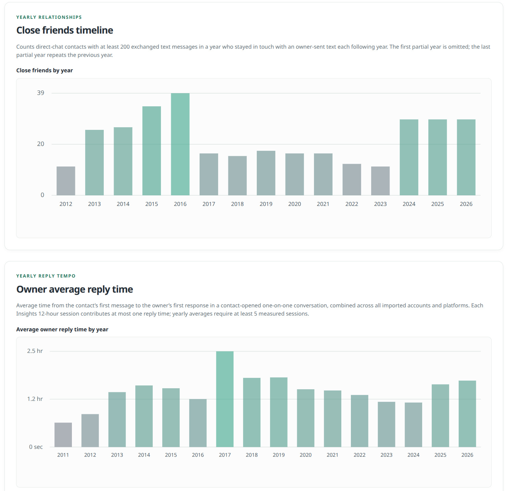

# Social Fossils

Social Fossils is a local-first tool for exploring personal messaging history.
Import your messaging exports and use a dashboard to understand activity,
conversations, and how relationships change over time.

[](https://telegram.me/antonmalkovdev)
[](https://www.linkedin.com/in/antmalk/)
[](./LICENSE)

## Run Project

**Requirements:** Install [Docker Engine and Compose](https://docs.docker.com/engine/install/) on Linux, or [Docker Desktop](https://docs.docker.com/desktop/setup/install/windows-install/) on Windows.

Export messages as **Telegram JSON**, **Instagram/Facebook ZIP with JSON files**, or **VK ZIP with HTML files**.

```sh
docker compose up --build
```

Open the dashboard at <http://localhost:3000>. The first startup builds the
images and applies database migrations automatically. Stop the services with
`Ctrl+C`.

## Features

- **Import messaging exports:** Upload exports from Telegram, Instagram,
  Facebook, and VK. Imports are processed and stored locally in PostgreSQL.
- **Explore your data:** Browse analytics about accounts, chats, contacts, and
  messages through a dashboard.
- **Understand relationships:** Review direct-message contact activity and
  continuity, including Active, Close, and exClose classifications.
- **Analyze group interactions:** Explore participant activity and statistics
  for group conversations.
- **Link identities across platforms:** Connect contacts that represent the
  same person across imported accounts.
- **Ask questions with the AI dashboard:** Use the assistant with read-only
  analytics tools. Local Ollama can also search chats and access message text;
  OpenAI-compatible models do not receive raw message text or user IDs.
- **Run locally:** Start the app and its supporting services with Docker
  Compose. Your messaging exports are personal data; keep them private.

## Screenshots

### Owner account analytics



### Close friends


### Chats analytics


### Communication balance


### Forgotten friends


## Stack

Python, FastAPI, SQLAlchemy 2, PostgreSQL, Alembic, React, TypeScript, Vite, Airflow, MCP.

### Development

Start the development stack with bind mounts and code reload:

```sh
docker compose -f docker-compose.yml -f docker-compose.dev.yml up --build
```

The backend applies database migrations automatically on startup. Host-side
tooling is optional; use it when running frontend or backend tests outside
Docker.

### Optional host-side setup

```sh
cd frontend
nvm install
npm install
cd ..
python3 -m venv .venv
source .venv/bin/activate
pip install -r backend/requirements.txt
```

### Test

- Backend: `cd backend && pytest`
- Frontend: `cd frontend && npm test`

### Local LLM

- Ollama is optional; the dashboard works without it. Install Ollama on the
  host and pull a model, for example `ollama pull qwen3:8b`.
- The Compose configuration defaults to
  `OLLAMA_BASE_URL=http://host.docker.internal:11434`, as shown in
  `.env.example`. Ollama setup varies by host OS; keep it restricted to trusted
  local traffic.

#### Linux with systemd

- If the default URL is unreachable, get the Docker network gateway with
  `docker network inspect social_fossils_default --format '{{(index .IPAM.Config 0).Gateway}}'`.
- Run `sudo systemctl edit ollama`; add `[Service]` and
  `Environment="OLLAMA_HOST=<gateway>:11434"` using that gateway.
- Set `OLLAMA_BASE_URL=http://<gateway>:11434` in `.env`, then apply the
  setting with
  `sudo systemctl daemon-reload && sudo systemctl restart ollama`.
- Recreate the backend with
  `docker compose up -d --force-recreate backend`.

## Architecture and logic charts

These diagrams describe the application implemented in this repository. They
use Mermaid in Markdown so the source remains editable and renderable in
compatible viewers.

### Diagrams

- [System architecture](./docs/charts/architecture.md) — Compose services, storage, and
  runtime boundaries.
- [Data flow](./docs/charts/data-flow.md) — Upload/import, dashboard analytics, and AI
  request paths.
- [Upload and import logic](./docs/charts/upload-import.md) — Validation, job dispatch,
  Airflow task outcomes, retries, and idempotent persistence.
- [Analytics logic](./docs/charts/analytics.md) — Cache behavior, friendship status,
  communication balance, forgotten contacts, and group interactions.
- [Identity linking logic](./docs/charts/identity-links.md) — Identity grouping, merge,
  unlink, and validation rules.
- [AI chat logic](./docs/charts/ai-chat.md) — Provider selection, read-only tools, and
  local-versus-cloud data access.

### Implementation references

The diagrams are based on [docker-compose.yml](docker-compose.yml),
[the FastAPI application](backend/app/main.py),
[the upload API](backend/app/routers/upload.py),
[the Airflow import DAG](airflow/dags/import.py),
[the analytics cache middleware](backend/app/analytics_cache_middleware.py),
[identity-link APIs](backend/app/routers/identity_links.py), and
[AI provider/tool logic](backend/app/ai/providers.py).

Update the relevant chart when changing a depicted boundary, decision, or
business rule. These diagrams summarize key workflows; they do not enumerate
every API route or metric.
