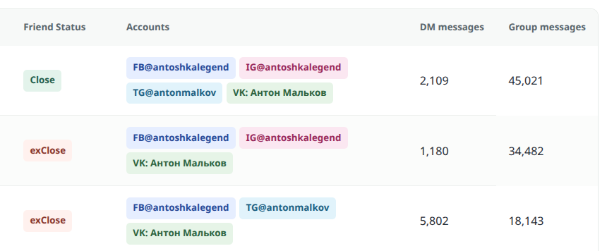
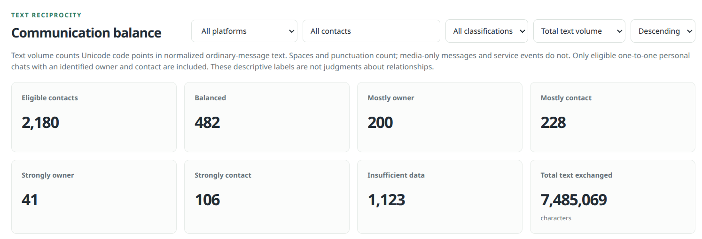
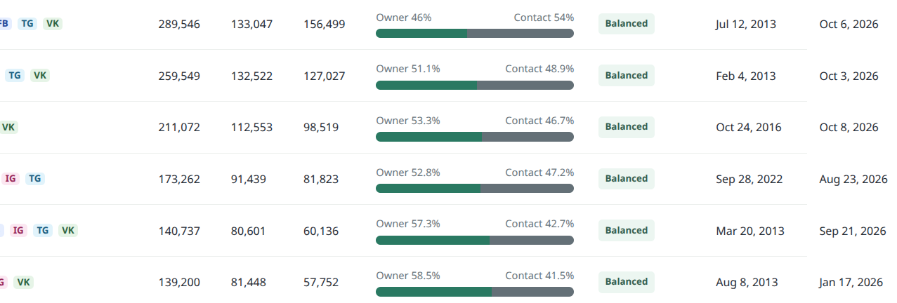

# Social Fossils

Social Fossils is a local-first tool for exploring personal messaging history.
Import your messaging exports and use a dashboard to understand activity,
conversations, and how relationships change over time.

## Features

- **Import messaging exports:** Upload exports from Telegram, Instagram,
  Facebook, and VK. Imports are processed and stored locally in PostgreSQL.
- **Explore your data:** Browse analytics about accounts, chats, contacts, and
  messages through a dashboard.
- **Understand relationships:** Review direct-message contact activity and
  continuity, including Active, Close, and exClose classifications.
- **Analyze group interactions:** Explore participant activity and statistics
  for group conversations.
- **Link identities across platforms:** Connect contacts that represent the
  same person across imported accounts.
- **Ask questions with the AI dashboard:** Use the assistant with read-only
  analytics tools. Local Ollama can also search chats and access message text;
  OpenAI-compatible models do not receive raw message text or user IDs.
- **Run locally:** Start the app and its supporting services with Docker
  Compose. Your messaging exports are personal data; keep them private.

## Screenshots

### Owner account analytics

### Close friends

### Chats analytics

### Communication balance

### Forgotten friends

### Run Project

`docker compose up --build`

### Optional: Local LLM

- Install Ollama on the host and pull a model, for example `ollama pull qwen3:8b`.
- The backend container must reach Ollama through the Docker network gateway. On Linux, get the gateway with `docker network inspect social_fossils_default --format '{{(index .IPAM.Config 0).Gateway}}'`.
- Run `sudo systemctl edit ollama`; add `[Service]` and `Environment="OLLAMA_HOST=<gateway>:11434"` using the gateway above.
- Set `OLLAMA_BASE_URL=http://<gateway>:11434` in `.env`. Keep Ollama restricted to trusted local traffic.
- Apply the setting with `sudo systemctl daemon-reload && sudo systemctl restart ollama`, then recreate the backend with `docker compose up -d --force-recreate backend`.

### Stack

Python, FastAPI, SQLAlchemy 2, PostgreSQL, Alembic, React, TypeScript, Vite, Airflow, MCP.

## Social media

- [GitHub](https://github.com/chigart)
- [Telegram](https://telegram.me/antonmalkovdev)
- [LinkedIn](https://www.linkedin.com/in/antmalk/)

## License

This project is distributed under the [MIT License](./LICENSE).

### Development

- Development startup (with bind mounts and reload): `docker compose -f docker-compose.yml -f docker-compose.dev.yml up`.
- `cd frontend`
- `nvm install`
- `npm install`
- `cd ..`
- `python3 -m venv .venv`
- `source .venv/bin/activate`
- `pip install -r requirements.txt`
- `docker compose exec backend alembic upgrade head`

### Test

- Backend: `cd backend && pytest`
- Frontend: `cd frontend && npm test`
