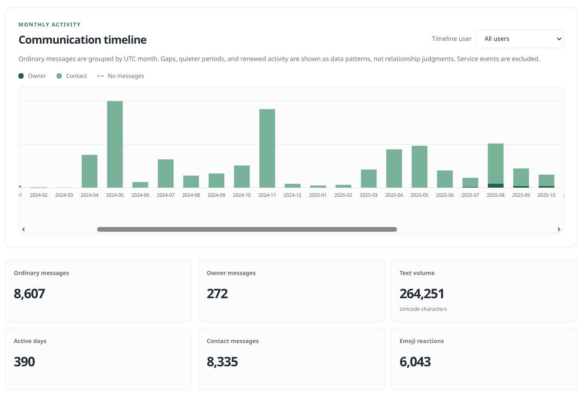
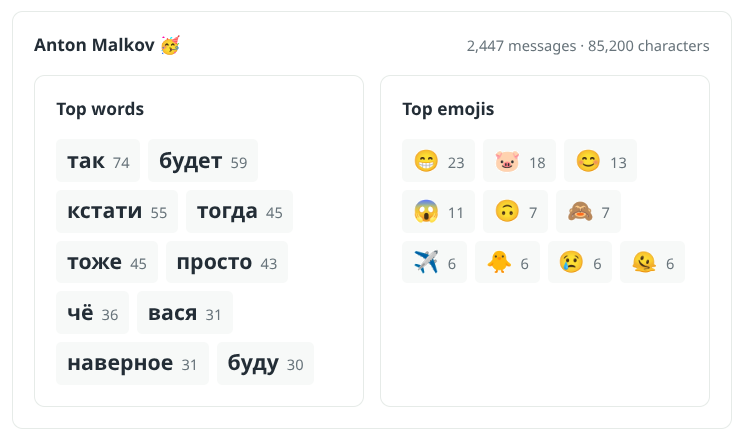
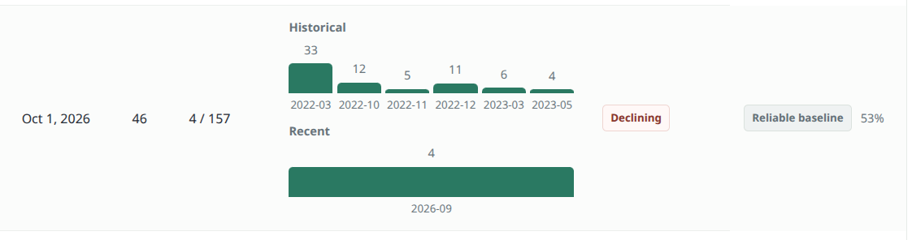

# Social Fossils

Social Fossils is a local-first tool for exploring personal messaging history.
Import your messaging exports and use a dashboard to understand activity,
conversations, and how relationships change over time.

## Features

- **Import messaging exports:** Upload exports from Telegram, Instagram,
  Facebook, and VK. Imports are processed and stored locally in PostgreSQL.
- **Explore your data:** Browse analytics about accounts, chats, contacts, and
  messages through a dashboard.
- **Understand relationships:** Review direct-message contact activity and
  continuity, including Active, Close, and exClose classifications.
- **Analyze group interactions:** Explore participant activity and statistics
  for group conversations.
- **Link identities across platforms:** Connect contacts that represent the
  same person across imported accounts.
- **Ask questions with the AI dashboard:** Use the assistant with read-only
  analytics tools. Local Ollama can also search chats and access message text;
  OpenAI-compatible models do not receive raw message text or user IDs.
- **Run locally:** Start the app and its supporting services with Docker
  Compose. Your messaging exports are personal data; keep them private.

## Screenshots

### Owner account analytics


### Close friends


### Chats analytics




### Communication balance


### Forgotten friends



## Run Project

Prerequisite: Docker Engine with Docker Compose v2. Start the app and its
supporting services:

```sh
docker compose up --build
```

Open the dashboard at <http://localhost:3000>. The first startup builds the
images and applies database migrations automatically. Stop the services with
`Ctrl+C`.

### Optional: Local LLM

- Ollama is optional; the dashboard works without it. Install Ollama on the
  host and pull a model, for example `ollama pull qwen3:8b`.
- The Compose configuration defaults to
  `OLLAMA_BASE_URL=http://host.docker.internal:11434`, as shown in
  `.env.example`. Ollama setup varies by host OS; keep it restricted to trusted
  local traffic.

#### Linux with systemd

- If the default URL is unreachable, get the Docker network gateway with
  `docker network inspect social_fossils_default --format '{{(index .IPAM.Config 0).Gateway}}'`.
- Run `sudo systemctl edit ollama`; add `[Service]` and
  `Environment="OLLAMA_HOST=<gateway>:11434"` using that gateway.
- Set `OLLAMA_BASE_URL=http://<gateway>:11434` in `.env`, then apply the
  setting with
  `sudo systemctl daemon-reload && sudo systemctl restart ollama`.
- Recreate the backend with
  `docker compose up -d --force-recreate backend`.

## Stack

Python, FastAPI, SQLAlchemy 2, PostgreSQL, Alembic, React, TypeScript, Vite, Airflow, MCP.

## Social media

- [GitHub](https://github.com/chigart)
- [Telegram](https://telegram.me/antonmalkovdev)
- [LinkedIn](https://www.linkedin.com/in/antmalk/)

## License

This project is distributed under the [MIT License](./LICENSE).

## Development

Start the development stack with bind mounts and code reload:

```sh
docker compose -f docker-compose.yml -f docker-compose.dev.yml up --build
```

The backend applies database migrations automatically on startup. Host-side
tooling is optional; use it when running frontend or backend tests outside
Docker.

### Optional host-side setup

```sh
cd frontend
nvm install
npm install
cd ..
python3 -m venv .venv
source .venv/bin/activate
pip install -r backend/requirements.txt
```

### Test

- Backend: `cd backend && pytest`
- Frontend: `cd frontend && npm test`
