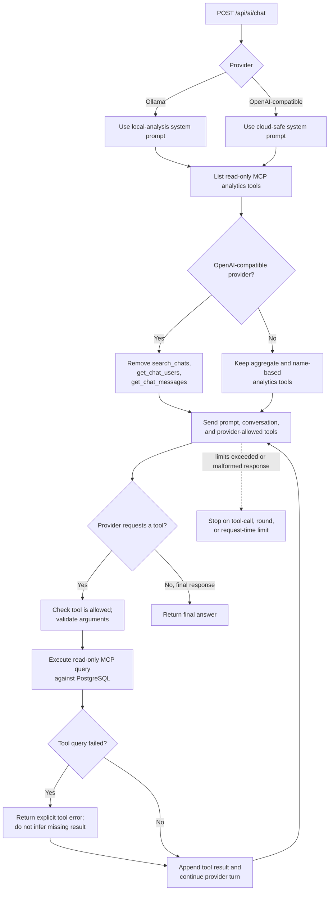

# AI chat and data boundaries

Both providers can use read-only analytics tools for aggregates and account or
contact names. Only local Ollama receives the `search_chats`,
`get_chat_users`, and `get_chat_messages` tool definitions; these can expose
chat lookup, participant IDs, and raw message text. OpenAI-compatible requests
use a public HTTPS base URL and require an API key, which is supplied with the
request and is not persisted.

The server validates requested tool names and arguments, limits tool use to
eight calls and six rounds, and bounds the request duration. Analytics failures
are surfaced to the model as errors rather than fabricated values. Tools
cannot execute arbitrary SQL or mutate the database.
