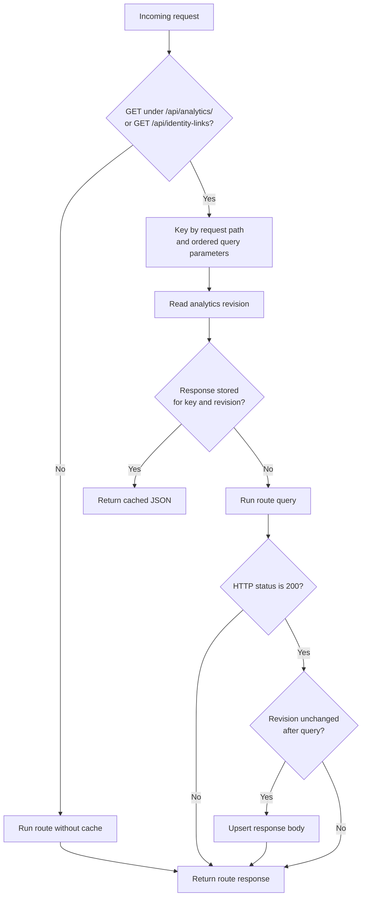
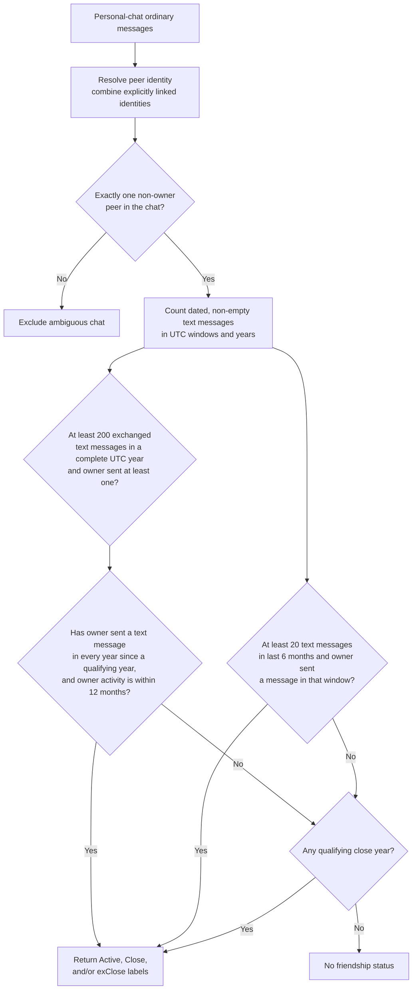
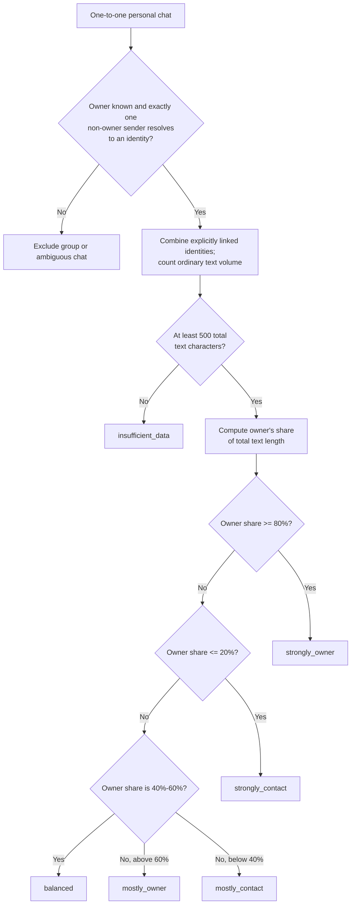
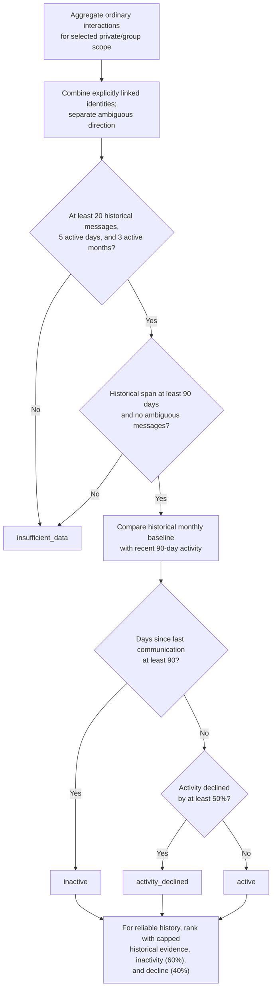
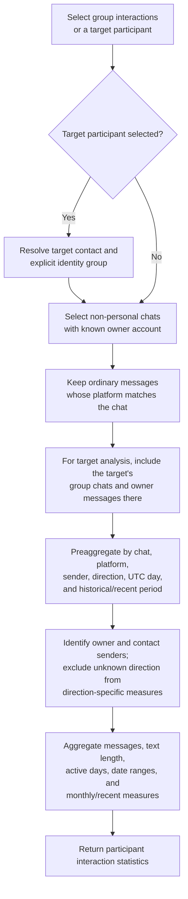

# Analytics logic

## Cache lookup and invalidation

The revision combines the analytics cache version with import-session count,
maximum ID and latest finish time, plus identity-link-event count and maximum
ID. Completed imports and identity-link actions therefore make affected cache
keys miss without deleting old entries. A request result is stored only when
its revision is still current. Time-dependent analytics remain cached until
the revision changes.

## Direct-message friendship status

Active and Close may both apply. A contact with historical Close evidence but
not current Close status is exClose. The close-friends yearly timeline uses
complete UTC years; when the latest year is partial, it repeats the previous
year's count.

## Communication balance

These are descriptive heuristics, not scientifically validated relationship
measurements. Text length is based on stored text content, not bytes or media.

## Forgotten contacts

The analysis requires a meaningful historical baseline before assigning an
activity classification. Its score is an ordering aid, not a probability.

## Group interactions

Group analysis works from ordinary messages and daily preaggregation. When a
specific participant is requested, explicitly linked identities are resolved
and the query includes owner activity in the target's eligible group chats.
