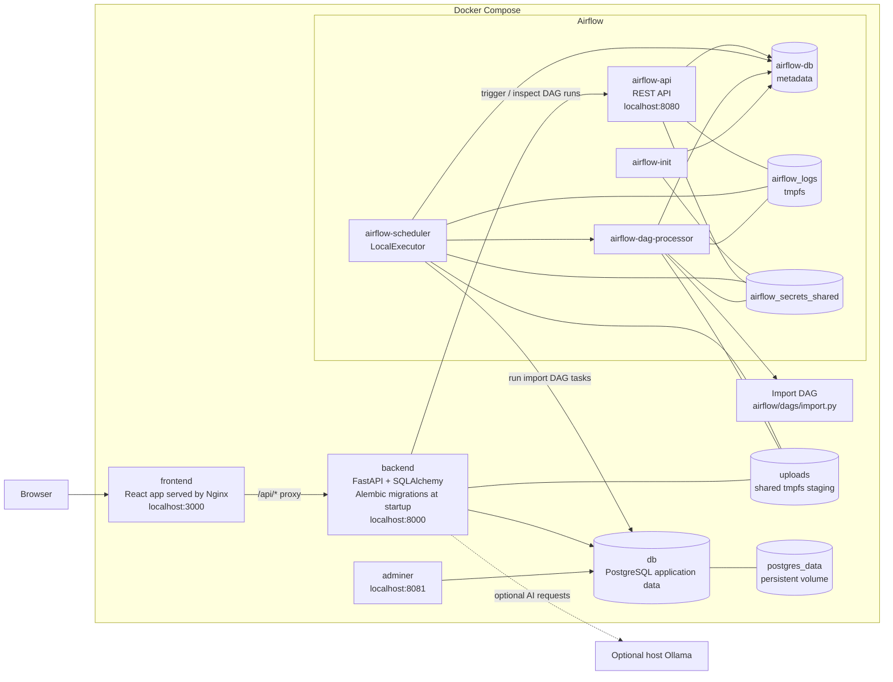

# System architecture

The default local Compose stack separates the browser UI, FastAPI application,
Airflow orchestration, and application database. The upload staging volume is
shared between the API and Airflow tasks. Publicly exposed service ports are
bound to localhost.

`uploads` and `airflow_logs` are RAM-backed Compose volumes. `airflow-db` also
uses a temporary filesystem; the application PostgreSQL data uses the
`postgres_data` named volume. The frontend and application API, PostgreSQL,
Airflow API, and Adminer host ports are bound to `127.0.0.1`.

The browser sends API requests through the frontend's Nginx `/api/` proxy.
During imports, FastAPI creates jobs and triggers Airflow; Airflow runs the
import tasks against the shared staged file and the application database.
Parsing and platform-specific persistence remain in backend importer/parser
modules rather than the DAG. Ollama is optional and runs outside Compose when
configured.
