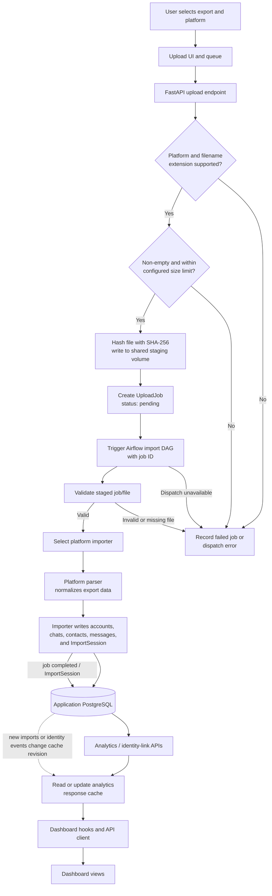
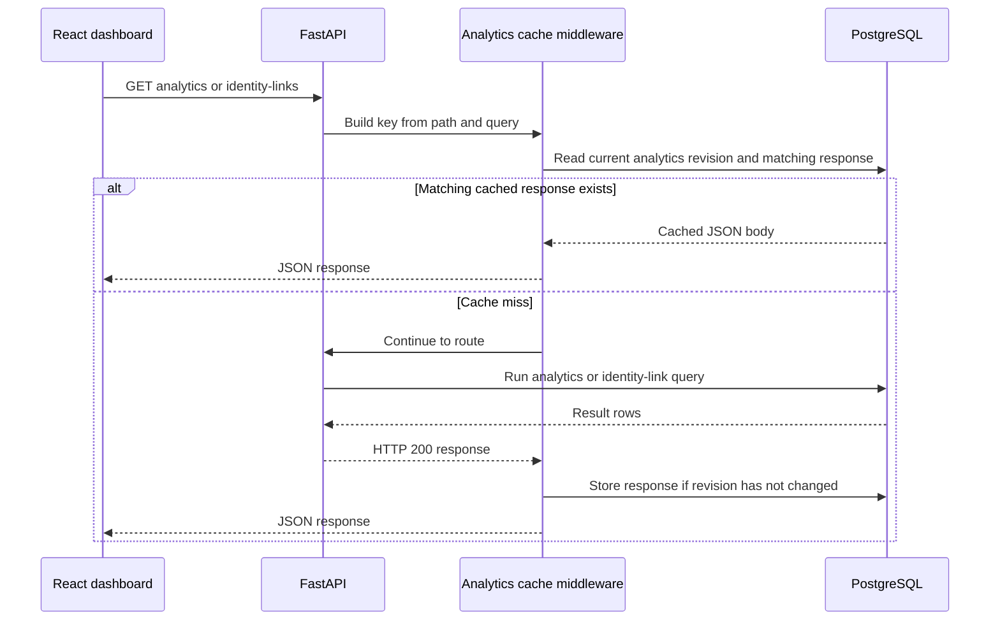

# Data flow

## Upload, import, and dashboard

Supported exports are Telegram JSON, Instagram/Facebook ZIP archives, and VK
ZIP archives with HTML files. The API stages bytes under their SHA-256 digest;
the filename remains job metadata. Airflow and the backend share the staging
volume, and Airflow calls the backend's platform importer rather than
implementing parsing itself.

Uploading the same file again is allowed. The API reports a duplicate-file
warning, while importer uniqueness constraints and PostgreSQL conflict handling
prevent existing messages from being inserted again.

## Analytics request path

Only GET requests under `/api/analytics/` and `GET /api/identity-links` are
cached. Upload status and other live job information bypass this cache. See
[analytics logic](./analytics.md) for revision and invalidation behavior.
