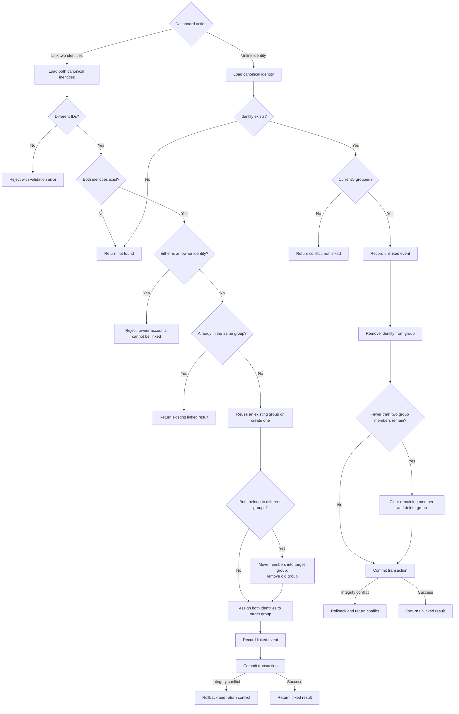

# Cross-platform identity links

Link requests reject the same identity twice, unknown IDs, and owner identities.
Linking two identities already in the same group is idempotent. When two
existing groups are joined, all members move to the target group before the old
group is removed. Unlink events are retained; a group with fewer than two
remaining members is dissolved.

Identity-link events are part of the analytics cache revision. The link or
unlink transaction commits the group changes and event together; integrity
errors roll back and return a conflict response.
