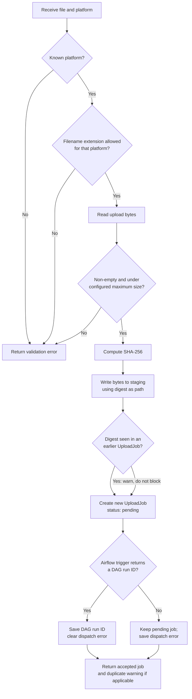
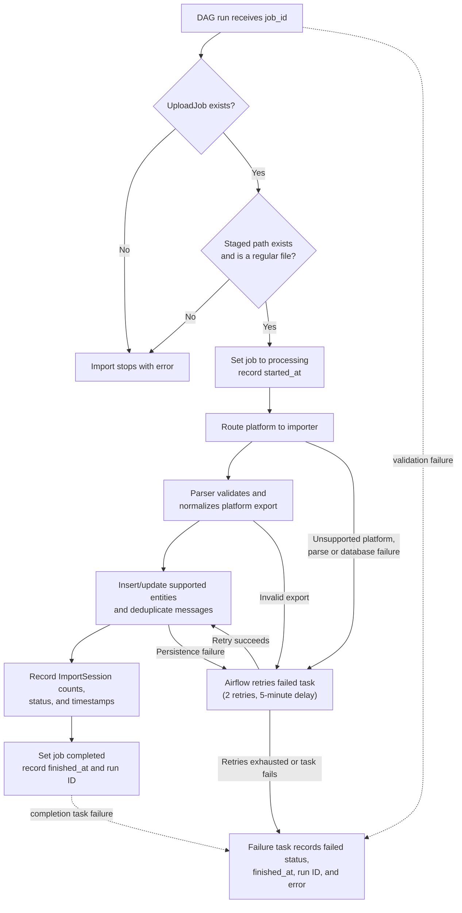

# Upload and import logic

## Upload acceptance and dispatch

A repeated digest does not reuse an old job or stop a new import. This permits
re-imports while message-level uniqueness makes persistence idempotent. A
dispatch failure leaves a pending job without an Airflow run ID; only such
pending jobs can be retried through the retry endpoint.

## Airflow tasks and import persistence

The DAG order is `validate_export -> perform_import -> mark_completed`.
`mark_failed` is a `ONE_FAILED` task downstream of the validation, import, and
completion tasks. Airflow may retry failed work before the failure task records
the terminal job status.

Each platform importer uses its parser and SQLAlchemy models. It records
`ImportSession` status, timestamps, and message counts; failures roll back the
import transaction and propagate to Airflow. Re-imports use database uniqueness
and `ON CONFLICT DO NOTHING` for messages rather than overwriting existing
messages.
